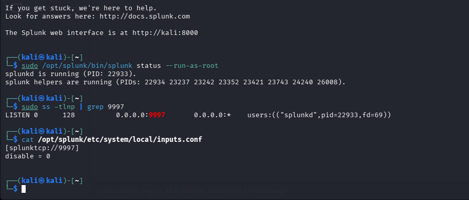
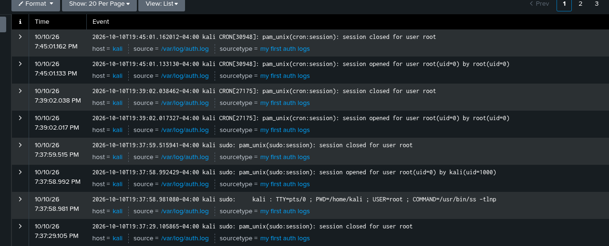

# Splunk SIEM Lab - Linux Auth Log Monitoring

## Overview
Configured Splunk Enterprise on Kali Linux as a SIEM to monitor authentication logs. This lab simulates real SOC Analyst Tier 1 workflow for log ingestion and security monitoring.

**Environment:** Kali Linux | Splunk Enterprise 9.x  
**Log Source:** `/var/log/auth.log`  
**Events Ingested:** 158+  

### Architecture
Kali -> inputs.conf Monitor -> TCP 9997 Receiver -> Splunk Index -> Search & Detection

### Lab Steps

#### 1. Configured Log Monitor (inputs.conf)
Edited Splunk `inputs.conf` to continuously monitor `/var/log/auth.log` for SSH, sudo, and authentication events.

#### 2. Verified Log Source (auth.log)
Confirmed Linux authentication logs contain security-relevant events.

#### 3. Data Analysis & SPL Detection
Used SPL to analyze ingested events and hunt for failed authentication patterns.

### SPL Query Used
`index=main sourcetype=linux:auth "Failed password" | stats count by src_ip | sort -count`

### Skills Demonstrated
- Splunk Enterprise Installation & Configuration
- inputs.conf & Receiving Port 9997 Setup
- Linux Auth Log Analysis
- SPL (Search Processing Language) Basics
- SOC Log Ingestion Workflow

### MITRE ATT&CK Mapping
- T1110 - Brute Force
- T1078 - Valid Accounts (monitoring)

### Next Lab: Building Brute Force Alert Rule
